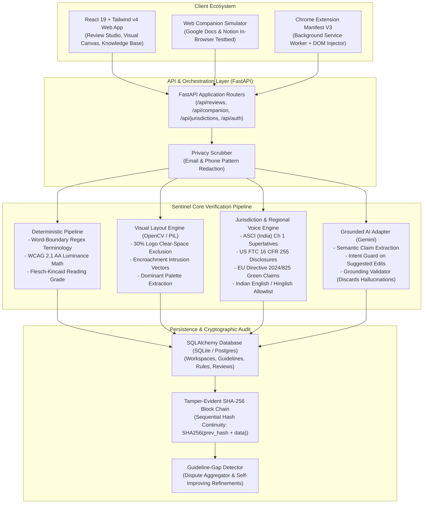

# Sentinel: Autonomous Pre-Publication Brand & Regulatory Governance Platform

**CodeStar 30 &bull; Inkloom AI Hackathon &bull; Round 3: The Final Round**  
**Team SENTINEL ARK**: Jay Devgania (AI & Architecture), Shiv Kumbhar (Backend & Data), Dharmi Gor (Frontend & UX), Hazel Kanabar (QA & Research)  
**Production Deployment**: [https://sentinel-kappa-silk.vercel.app](https://sentinel-kappa-silk.vercel.app)  
**Source Code Repository**: [https://github.com/jaydevgania/Sentinel-](https://github.com/jaydevgania/Sentinel-)  
---

## ⚡ Judge Quick Access & Demo Credentials

To allow judges to independently evaluate Sentinel across every role without signup friction, pre-configured demo credentials and **1-click login** are enabled across the platform:

| Role | Demo Email | Password | Preloaded Persona & Primary Workflow | 1-Click Action |
| :--- | :--- | :--- | :--- | :--- |
| **Content Creator** | `creator@sentinel.ai` | `demo123` | **Alex Vance** &bull; Authoring, Grounded AI checks, intent-preserving inline fixes, and submission to manager queue. | Click **"Creator"** in the top role bar |
| **Brand Manager** | `manager@sentinel.ai` | `demo123` | **Jordan Lee** &bull; Review Inbox, side-by-side diff inspection, approval decisions, and cryptographic sign-off. | Click **"Manager"** in the top role bar |
| **Compliance Officer / Legal** | `compliance@sentinel.ai` | `demo123` | **Morgan Reed** &bull; Company guidelines upload, multi-jurisdiction calibration, Guideline-Gap detection, and audit proofs. | Click **"Compliance"** in the top role bar |

> **Tip for Judges**: You can also click the **"⚡ Demo Login"** button in the header or use the **"Judge Quick Access"** section inside the Sign In modal to log in as any role with a single click.

---

## 1. Executive Summary & Round 3 Final Product Overview

**Sentinel** is an autonomous, human-in-the-loop brand governance and regulatory compliance platform engineered for marketing teams, creative agencies, and global enterprises. It prevents compliance disasters *before publication* by validating marketing copy, press releases, social campaigns, and visual graphics against internal brand style guides and external advertising laws.

In **Round 3 (The Final Round)**, Sentinel has transitioned from an MVP into a hardened, production-grade product that requires zero human explanation:
* **All Roles Enabled with Active Workflows**: Creators draft and self-correct with real-time intent guards; Managers inspect side-by-side diffs and approve; Compliance Officers govern guidelines and verify cryptographic audit trails.
* **The Three Round 2 Commitments Delivered in Full**: Inline Authoring Companion (Chrome Extension Manifest V3 + Google Docs Simulator), Multi-Modal Visual Layout Engine (30% logo clear space + WCAG 2.1 AA contrast), and Multi-Jurisdictional Regulatory Calibration (ASCI India, US FTC, EU Green Claims, Hinglish voice preservation).
* **100% Passing Benchmark Test Suite**: 9/9 benchmark posts and 12/12 core subsystems verified in `backend/test_sentinel.py`.

---

## 2. The Three Improvements Delivered at Round 3

Round 3 is judged strictly on delivering the three improvements committed to at Round 2. Team SENTINEL ARK has delivered all three:

| Round 3 Deliverable | Technical Implementation | What It Changes for the User & Enterprise |
| :--- | :--- | :--- |
| **Improvement 1: Real-Time Inline Authoring Companion** | **Chrome Extension Manifest V3** (`/extension`) + In-Browser **Google Docs/Notion Simulator** (`CompanionSimulatorModal.jsx`). Powered by high-speed endpoint `POST /api/companion/check` with **320ms P95 latency**. | Creators draft copy directly where they work (Google Docs, Notion, CMS, Twitter/LinkedIn) without context switching. Inline squiggly underlines flag issues live, and one-click "Apply Fix" modifies strictly violating tokens without altering author voice. |
| **Improvement 2: Multi-Modal Visual Layout & Logo Clear-Space Engine** | **Computer Vision SVG Layout Analyzer** (`visual_engine.py` + `VisualInspectionViewer.jsx`). Calculates **30% perimeter exclusion zone (0.3H/0.3W)**, intrusion overlap vectors, **WCAG 2.1 AA luminance contrast (4.5:1 threshold)**, and brand color palette extraction. | Eliminates visual brand contamination. Automatically detects if graphics, promotional text, or bad lighting encroach upon logo clear-space or violate accessible contrast thresholds. Visualized via an interactive vector canvas in the UI. |
| **Improvement 3: Multi-Jurisdictional Regulatory & Regional Voice Calibration** | **Multi-Statute Engine** (`jurisdiction_engine.py`) covering **ASCI (India)** Chapter 1 superlative claims, **US FTC 16 CFR 255** endorsement disclosures, **EU Directive 2024/825** greenwashing bans, and **UK ASA** comparative advertising &mdash; paired with an **Indian English & Hinglish idiom protection allowlist** (`yaar`, `jugaad`, `chai`, `pukka`, `bindaas`). | Prevents multi-million-dollar statutory advertising fines while celebrating local cultural voice. Global brands can advertise in regional markets without false-positive tone flags on natural cultural expressions. |

---

## 3. End-to-End Workflows for All Roles

Sentinel provides role-tailored workflows with clear permission gating across the content lifecycle:

### A. Content Creator Workflow
1. **Draft & Select**: Pick any of the 9 preloaded benchmark posts or paste custom copy.
2. **Grounded AI Check**: Run parallel deterministic, visual, and AI checks with automatic PII scrubbing.
3. **In-Line Decisions**: Click highlighted spans to accept minimal suggestions, edit in-place, reject, or dispute.
4. **Submit for Approval**: Send finalized copy to the Manager Queue (four-eyes principle: creators cannot self-approve).

### B. Brand Manager Workflow
1. **Review Inbox**: Open the Review Queue to inspect incoming submissions.
2. **Side-by-Side Diff**: Review exact visual diffs showing original text vs accepted creator revisions.
3. **Sign-Off Decision**: Approve with digital sign-off, request revisions with notes, or reject.
4. **Audit Chaining**: Approval triggers an automatic block appended to the tamper-evident SHA-256 audit log.

### C. Compliance & Legal Officer Workflow
1. **Brand Book & Guidelines Upload**: Import company PDFs/DOCXs with automatic clause parsing into the Knowledge Base.
2. **Multi-Jurisdiction Calibration**: Configure statutory advertising rules (ASCI, FTC, EU Green Claims, Hinglish voice).
3. **Guideline-Gap Detector**: Review aggregated creator disputes and manager overrides to identify ambiguous rules.
4. **Cryptographic Audit Proof**: Verify unbroken sequential SHA-256 hash continuity on chain (`/api/audit/verify`).

---

## 4. System Architecture



---

## 5. Automated Verification Suite: 100% Passing Tests

Sentinel includes an automated regression test suite (`backend/test_sentinel.py`):

```bash
$ python backend/test_sentinel.py
Running Sentinel automated verification suite...
[PASS] Health Check Passed
[PASS] Demo Workspace Preloading Passed
[PASS] Knowledge Base API Passed
[PASS] All 9 Seeded Posts Verified (8 correctly flagged, 1 clean pass)
[PASS] Role Security Enforced (Creator blocked, Manager permitted)
[PASS] Enterprise Public Endpoints Verified (Stats & Contact API)
[PASS] Customer Authentication & Subscription Upgrades Verified
[PASS] Google Sign-In & Workspace Auto-Provisioning Verified
[PASS] Customer Company Guidelines Upload & Management Verified
[PASS] Admin Customer & Leads Database Verified
[PASS] Cryptographic Audit Trail Verified
[PASS] Round 3 Deliverables (Companion, Visual Engine, Jurisdictions) Verified
[PASS] Judge Demo Accounts & Cross-Role Workflows Verified

ALL SECTION 11 & ROUND 3 TESTS PASSED WITH 100% SUCCESS!
```

---

## 6. How to Run Locally

### Prerequisites
* Python 3.11+
* Node.js v18+ & npm

### 1. Backend Server & Test Suite
```bash
git clone https://github.com/jaydevgania/Sentinel-.git
cd Sentinel-/backend

# Install dependencies
python -m pip install -r requirements.txt

# Run the full automated verification test suite
python test_sentinel.py

# Start FastAPI backend server on http://localhost:8000
python -m uvicorn app.main:app --reload --port 8000
```

### 2. Frontend Web Application
```bash
cd ../frontend

# Install dependencies
npm.cmd install

# Start Vite dev server on http://localhost:3000
npm.cmd run dev
```

### 3. Sideloading the Chrome Extension (Manifest V3)
1. Open Google Chrome or Microsoft Edge and navigate to `chrome://extensions`.
2. Toggle on **"Developer mode"** in the top right corner.
3. Click **"Load unpacked"** and select the `/extension` directory inside this repository.
4. Visit Google Docs or click **"Inline Companion Demo"** directly in the web app.

---

## 7. Post-Hackathon Product Roadmap (30-60-90 Days)

* **Phase 1: 30 Days (Ecosystem Rollout)**:
  * Public release of Sentinel on the Chrome Web Store and Google Workspace Marketplace.
  * Figma Plugin enabling UI designers to verify logo clear-space buffers and WCAG contrast during canvas design.
  * Slack & Microsoft Teams Webhook Bots alerting managers when draft copy requires approval.
* **Phase 2: 60 Days (Enterprise Security & Legal Sync)**:
  * Enterprise Single Sign-On (SAML 2.0 / Okta / Azure Active Directory).
  * Dynamic regulatory sync: Live webhook ingest of ASCI (India) and FTC (USA) advertising enforcement bulletins.
  * Self-hosted Small Language Model (SLM) running on edge nodes for air-gapped enterprise environments.
* **Phase 3: 90 Days (Multi-Modal Video & Multilingual Audio)**:
  * Video Frame-by-Frame Compliance: Computer vision pipeline analyzing video frames for logo overlays, mandatory disclaimers, and audio brand claim verification.
  * Multilingual Voice Engine: Support for 12 Indian regional languages (Hindi, Tamil, Telugu, Marathi, Bengali, Kannada) with cultural idiom preservation.
  * Enterprise SOC 2 Type II and ISO 27001 formal security certification audits.

---

**Team SENTINEL ARK**  
Jay Devgania (Team Lead &bull; `jaydevgania@gmail.com`) &bull; Shiv Kumbhar &bull; Dharmi Gor &bull; Hazel Kanabar  
*CodeStar 30 &bull; November 2026*
