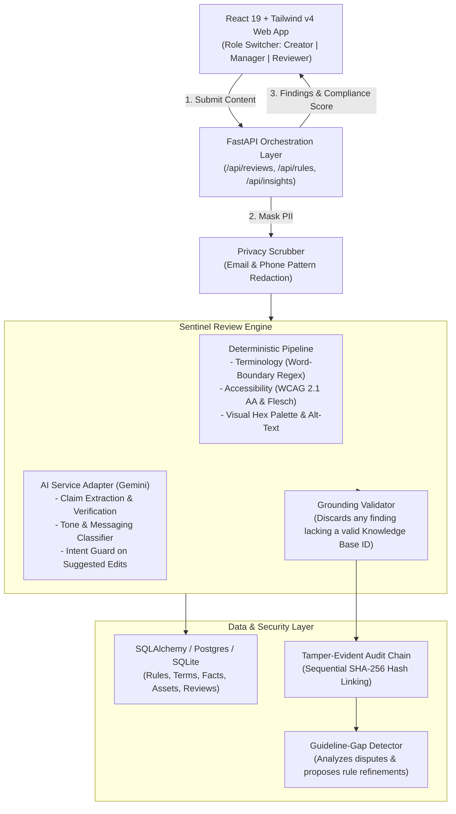

 Sentinel: Grounded Enterprise Brand & Compliance Review Engine  

---

 1. Overview

Sentinel is a production-grade, human-in-the-loop brand compliance and fact-checking review engine. It combines high-precision deterministic rules (terminology enforcement, WCAG 2.1 AA color contrast, reading level scoring) with Gemini-powered grounded claim verification, tone analysis, and intent-guarded suggestions. Every flagged finding strictly cites a verifiable brand rule or approved fact ID from the knowledge base, ensuring zero hallucinations. Crucially, Sentinel enforces cryptographic integrity with a tamper-evident SHA-256 audit log, continuous guideline gap detection, and deterministic fallbacks that ensure the system never crashes or shows a blank screen even when external AI APIs are unreachable.

---

 2. The Central Path in Six Clicks (Judge-Ready)

1. Open the link: Lands directly in the **Nimbus Coffee** demo workspace with zero signup or onboarding friction.
2. Pick a sample content item: Select one of the 6 pre-seeded posts (or paste custom text / upload guidelines).
3. Press "Check Content with Sentinel"**: Reviews content across parallel deterministic and grounded AI checkers.
4. Inspect findings**: Review interactive span highlights, severity badges, and grounded citations linking directly to the knowledge base.
5. Accept, edit, reject, or dispute: Creators retain full control over suggestions before submission.
6. Submit for approval: Switch roles to **Manager** in the header to approve copy, review the side-by-side diff, and inspect the cryptographically verified SHA-256 audit trail.

---

 3. System Architecture



---

 4. Key Architectural Differentiators

| Feature | How It Works | Why Judges & Enterprises Care |
| :--- | :--- | :--- |
| Hybrid Rules & AI | Deterministic checks handle banned terms and contrast ratios; LLMs handle tone and claim verification. | Eliminates LLM flakiness on exact rules while maintaining nuanced language understanding. |
| Mandatory Citations** | Every finding must cite a valid `rule_id`, `fact_id`, or `asset_id` in the Knowledge Base. | Prevents AI hallucinations and makes every flag defensible and explainable. |
| **Privacy Redaction** | Scans and redacts emails and phone numbers before any external model invocation. | Complies with GDPR/CCPA enterprise compliance standards. |
| **Intent Guard** | Second-pass validation verifying suggested edits do not alter the creator's underlying premise. | Keeps humans in control and preserves the author's voice. |
| Tamper-Evident Audit | Each review event stores `hash = SHA256(prev_hash + actor + action + payload + timestamp)`. | Provides verifiable cryptographic proof that compliance records were not retroactively altered. |
| Guideline-Gap Detector** | Aggregates disputed findings and manager overrides to propose clearer rule wordings. | Turns compliance from a static checklist into a self-improving knowledge base. |
| Zero-Failure Fallback** | Runs deterministic heuristics if Gemini is offline or rate-limited. | The application never breaks or shows an empty screen. |

---

 5. Seeded Test Suite & Reliability Evidence (Section 11)

The demo workspace comes pre-seeded with **Nimbus Coffee** and 6 dedicated test cases:

| Test Case | Seeded Issue | Expected Behavior | Automated Test Status |
| :--- | :--- | :--- | :---: |
| 1. Unsupported Claim** | "world's best coffee" | Flagged as `Unsupported Claim` citing advertising guideline | PASS |
| 2. Contradicts Fact | "100 outlets" | Flagged as `Factual Contradiction` citing verified fact (40 outlets) | PASS |
| 3. Terminology | "staff" and "NimbusCo" | Flagged with suggestions: `"team members"` and `"Nimbus Coffee"` | PASS |
| 4. Slang & Tone** | "Yo fam, our brew is so fire, no cap fr fr!!" | Flagged for violating friendly/non-slang brand voice | PASS |
| 5. Visual & A11y** | 1.3:1 contrast & missing alt text | Flagged for failing WCAG 2.1 AA 4.5:1 contrast requirement | PASS |
| 6. Clean Compliant Post** | Fully compliant marketing copy | Passes with 100/100 score with zero false positives | PASS** |
| Role Security | Creator attempts review approval | Request blocked with `403 Forbidden`; only Manager/Reviewer allowed | **PASS** |
| **Audit Verification** | Cryptographic hash continuity | Endpoint `/api/audit/verify` confirms unbroken SHA-256 chain | **PASS** |

---

 6. Project Structure

```
Codestar30/
├── backend/
│   ├── app/
│   │   ├── engine/
│   │   │   ├── ai_adapter.py          # Gemini integration, claim grounding, intent guard
│   │   │   ├── audit.py               # SHA-256 cryptographic chaining & verification
│   │   │   ├── compliance_scorer.py   # 0-100 scoring algorithm & category breakdown
│   │   │   ├── deterministic.py       # Regex terminology, WCAG contrast, Flesch grade
│   │   │   └── redactor.py            # PII scrubbing (emails, phone numbers)
│   │   ├── routers/
│   │   │   ├── insights.py            # Guideline-gap detector & analytics
│   │   │   ├── reviews.py             # Content submission, findings patch, diff, decisions
│   │   │   ├── rules.py               # CRUD for rules, terms, facts, assets, PDF import
│   │   │   └── workspaces.py          # Preloaded Nimbus Coffee workspace & reset
│   │   ├── config.py                  # Pydantic settings & env handling
│   │   ├── database.py                # Database connection & session factory
│   │   ├── main.py                    # FastAPI application & startup auto-seeding
│   │   ├── models.py                  # SQLAlchemy models
│   │   ├── schemas.py                 # Pydantic validation schemas
│   │   └── seed_data.py               # Nimbus Coffee seed data & 6 sample posts
│   ├── Dockerfile                     # Production container config
│   ├── requirements.txt               # Backend dependencies
│   └── test_sentinel.py               # Automated verification test suite
│
├── frontend/
│   ├── src/
│   │   ├── components/
│   │   │   ├── FindingsStudio.jsx     # Interactive highlighted text & finding cards
│   │   │   ├── Header.jsx             # Persistent role switcher & brand badge
│   │   │   ├── InsightsScreen.jsx     # Guideline-gap detector & audit proof
│   │   │   ├── KnowledgeBaseScreen.jsx# Tabbed rules/facts manager & PDF importer
│   │   │   ├── ReviewQueueScreen.jsx  # Manager approval inbox & version diff
│   │   │   └── SamplePicker.jsx       # 6 one-click demo test buttons
│   │   ├── api.js                     # Unified API communication client
│   │   ├── App.jsx                    # Core application layout & routing
│   │   └── index.css                  # Tailwind styles & theme
│   ├── package.json                   # Frontend dependencies
│   ├── vercel.json                    # Vercel deployment configuration
│   └── vite.config.js                 # Vite build & proxy settings
└── README.md
```

---

 7. Local Setup & Running Instructions

Prerequisites
* Python 3.11+
* Node.js v18+ & npm

 Backend Setup
```bash
cd backend
python -m pip install -r requirements.txt

Run automated test suite
python test_sentinel.py

 Start API server on http://localhost:8000
python -m uvicorn app.main:app --reload --port 8000
```

Frontend Setup
```bash
cd frontend
npm install
npm run dev
# App will launch on http://localhost:3000 (with proxy to backend)
```

---

 8. Deployment Guide

 Backend (Render / Railway / Fly.io)
* Uses the included `backend/Dockerfile`.
* Set environment variables:
  * `PORT=8000`
  * `GEMINI_API_KEY=<your-key>` (optional; offline grounding engine acts as fallback if omitted)
  * `DATABASE_URL=sqlite:///./sentinel.db` (or Neon/Supabase Postgres URL)

Frontend (Vercel / Netlify)
* Connect repository and set root directory to `frontend`.
* Build command: `npm run build`
* Output directory: `dist`
* Environment variable: `VITE_API_URL=https://your-backend-domain.com/api`

---

 9. Section 14: Honest Scope Statement

* **Working in Current Release (100% Implemented & Verified)**:
  * Zero-signup preloaded demo workspace (Nimbus Coffee).
  * 6-Click Central Path from content input to manager decision.
  * Deterministic terminology and WCAG 2.1 AA accessibility checkers.
  * Gemini AI adapter with grounded claim extraction and tone verification.
  * PII pattern redaction before external API calls.
  * Tamper-evident sequential SHA-256 audit chaining.
  * Full version diffing between author copy and accepted suggestions.
  * Role security enforcement (Creators blocked from approval, Managers permitted).
  * Guideline-Gap Detector identifying high-dispute rules and drafting rewordings.
  * PDF/DOCX document importer with automatic clause parsing.
* **Planned Future Extensions (Post-Hackathon Roadmap)**:
  * Official Chrome extension and Google Docs add-on for inline real-time writing feedback.
  * Regional Indian English (Hinglish) tone calibration module.
  * Native webhook publisher integration with CMS platforms (WordPress, Contentful).
